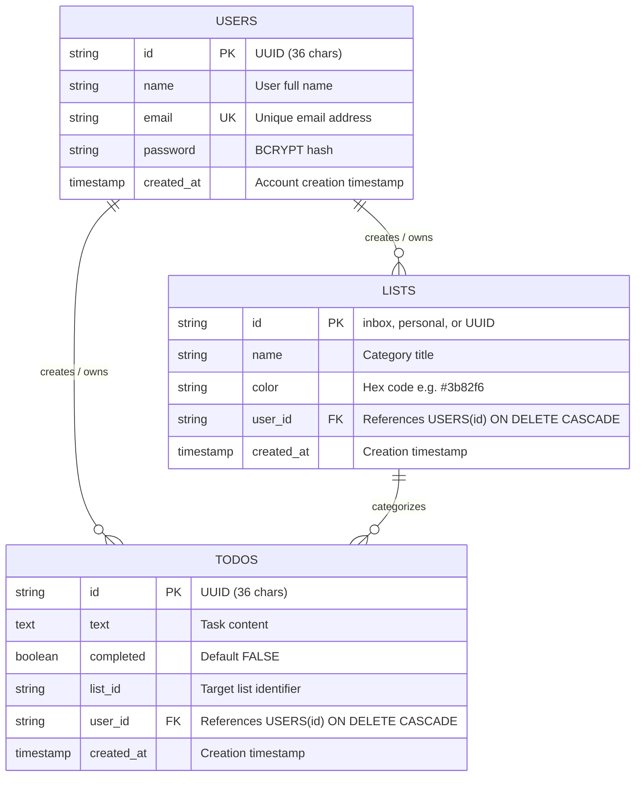

# 📋 Todo App DBMS — Full-Stack Task & List Management System

[](https://todo-app-dbms.vercel.app/)
[](https://todo-app-dbms.lovable.app/)
[](https://reactjs.org/)
[](https://www.typescriptlang.org/)
[](https://vitejs.dev/)
[](https://tailwindcss.com/)
[](https://www.php.net/)
[](https://www.mysql.com/)
[](https://threejs.org/)
[](LICENSE)

A modern, production-ready Full-Stack Task and List Management application designed with a decoupled **Client-Server Architecture**. Featuring a responsive **React 18 + TypeScript + Vite + Tailwind CSS** frontend styled with **shadcn/ui** and animated with **Three.js WebGL shaders**, powered by a robust **PHP + MySQL (PDO)** RESTful backend with stateless **JWT authentication**, **foreign key integrity (`ON DELETE CASCADE`)**, and **optimistic UI updates**.

---

## 📑 Table of Contents

- [Overview & Live Demos](#-overview--live-demos)
- [Key Features](#-key-features)
- [System Architecture](#-system-architecture)
- [DBMS & Database Design](#-dbms--database-design)
  - [Entity-Relationship (ER) Diagram](#entity-relationship-er-diagram)
  - [Data Dictionary & Schema](#data-dictionary--schema)
  - [Auto-Provisioning & Migrations](#auto-provisioning--migrations)
- [REST API Reference](#-rest-api-reference)
  - [Authentication Endpoints](#1-authentication-api-apiauth)
  - [Lists Endpoints](#2-lists-api-apilists)
  - [Todos Endpoints](#3-todos-api-apitodos)
- [Tech Stack](#-tech-stack)
- [Project Directory Structure](#-project-directory-structure)
- [Getting Started & Installation](#-getting-started--installation)
  - [Prerequisites](#prerequisites)
  - [1. Clone Repository](#1-clone-repository)
  - [2. Database & Backend Setup](#2-database--backend-setup)
  - [3. Frontend Setup](#3-frontend-setup)
- [Configuration & Environment Variables](#-configuration--environment-variables)
- [Troubleshooting & Common Questions](#-troubleshooting--common-questions)
- [Contributing](#-contributing)
- [License](#-license)

---

## 🌐 Overview & Live Demos

- **Production Deployment**: [https://todo-app-dbms.vercel.app/](https://todo-app-dbms.vercel.app/)
- **Lovable Preview**: [https://todo-app-dbms.lovable.app/](https://todo-app-dbms.lovable.app/)
- **Repository**: [https://github.com/Akki-74/todo-app-dbms](https://github.com/Akki-74/todo-app-dbms)

This project demonstrates clean database management principles (normalization, referential integrity, cascading deletions) coupled with modern frontend engineering patterns (optimistic state updates, custom reducers, error boundaries, and dynamic shader-based backgrounds).

---

## ✨ Key Features

### 🔐 Secure Authentication & Session Management
- **Stateless JWT Tokens**: HMAC SHA-256 signed JSON Web Tokens (30-day persistence).
- **Secure Password Hashing**: Passwords encrypted using PHP's native `password_hash()` with BCRYPT algorithms.
- **Auto-Token Verification & Refresh**: Automatically validates token validity on boot, issues fresh credentials, and protects private routes with React Router navigation guards.
- **Protected API Endpoints**: Centralized `AuthMiddleware` verifies `Bearer <token>` in the HTTP `Authorization` header.

### 📋 Task & Custom List Management
- **Complete CRUD Operations**: Create, view, inline-edit, toggle completion, and delete tasks and lists.
- **Categorization & Custom Palettes**: Assign personalized colors and custom names to task lists.
- **Automatic Seed Defaults**: Automatically provisions standard categories (`Inbox`, `Personal`, `Work`) per user on signup.
- **Dynamic Filter Tabs**: Filter tasks seamlessly between **All**, **Active**, and **Completed** states.
- **Protected System Defaults**: System-critical lists (like `Inbox`) are protected against accidental renaming or deletion.

### 📊 Real-Time Analytics & Dashboard
- **Interactive Data Visualization**: Embedded **Recharts** donut chart displaying completed vs. pending tasks.
- **Completion Metrics**: Live percentage progress bars with dynamic color stages (warning, primary, success).
- **Per-List Overview**: Visual breakdown of task density and completion statistics across every custom category.

### 🎨 Next-Level UI/UX & WebGL Shaders
- **Interactive Three.js Canvas**: Background features an interactive WebGL plane with custom vertex and fragment GLSL shaders that dynamically distort and ripple in response to mouse velocity.
- **Glassmorphism Design**: Frosted glass effects (`backdrop-blur-md`, semi-transparent cards, and subtle border highlights).
- **Dark, Light & System Themes**: Built-in `ThemeContext` supporting light, dark, and system color preferences with instant persistence in `localStorage`.
- **Fully Responsive**: Mobile-friendly sidebar drawer, touch-target optimizations, and smooth CSS transitions.

### ⚡ Performance & Reliability
- **Optimistic UI Updates**: State mutations render instantly before server response; automatically rolls back changes and emits a toast error if a network or backend failure occurs.
- **React Error Boundary**: Catches unforeseen runtime exceptions gracefully with a single-click state reset button.
- **Automated Schema Provisioning**: Database tables and relational schemas are auto-generated on first connection without requiring manual SQL imports.

---

## 🏛️ System Architecture

```
┌────────────────────────────────────────────────────────────────────────┐
│                          CLIENT (BROWSER)                              │
│                                                                        │
│   React 18  │  TypeScript  │  Tailwind CSS  │  shadcn/ui  │  Three.js  │
│   ┌────────────────────────────────────────────────────────────────┐   │
│   │  Contexts: AuthContext | TodoContext (useReducer) | Theme      │   │
│   └───────────────────────────────┬────────────────────────────────┘   │
│                                   │ Axios / Fetch (apiClient)          │
└───────────────────────────────────┼────────────────────────────────────┘
                                    │ HTTP Requests with JWT
                                    ▼
┌────────────────────────────────────────────────────────────────────────┐
│                        BACKEND (PHP REST API)                          │
│                                                                        │
│  API Gateway (backend/api/index.php + .htaccess Rewrite Rules)         │
│  ┌──────────────────────────────────────────────────────────────────┐  │
│  │ Middlewares: AuthMiddleware (JWT Validation via HMAC-SHA256)      │  │
│  ├──────────────────────────────────────────────────────────────────┤  │
│  │ Controllers: AuthController | TodoController | ListController    │  │
│  ├──────────────────────────────────────────────────────────────────┤  │
│  │ Models: User | Todo | ListModel                                  │  │
│  └───────────────────────────────┬──────────────────────────────────┘  │
│                                  │ PDO (PHP Data Objects)              │
└──────────────────────────────────┼─────────────────────────────────────┘
                                   │ SQL Queries
                                   ▼
┌────────────────────────────────────────────────────────────────────────┐
│                         DATABASE (MySQL DBMS)                          │
│                                                                        │
│   Database: `todo_app`                                                 │
│   ├── Table `users` (id, name, email, password, created_at)            │
│   ├── Table `lists` (id, name, color, user_id, created_at)             │
│   └── Table `todos` (id, text, completed, list_id, user_id, created)   │
│       [Foreign Keys with ON DELETE CASCADE]                            │
└────────────────────────────────────────────────────────────────────────┘
```

---

## 🗄️ DBMS & Database Design

### Entity-Relationship (ER) Diagram



### Data Dictionary & Schema

#### 1. `users` Table
Stores registered user credentials and metadata.

| Column | Data Type | Constraints | Description |
| :--- | :--- | :--- | :--- |
| `id` | `VARCHAR(36)` | **PRIMARY KEY** | Unique identifier generated on registration. |
| `name` | `VARCHAR(255)` | `NOT NULL` | Display name of the user. |
| `email` | `VARCHAR(255)` | `NOT NULL`, **UNIQUE** | User login email. |
| `password` | `VARCHAR(255)` | `NOT NULL` | Bcrypt-hashed password string. |
| `created_at`| `TIMESTAMP` | `DEFAULT CURRENT_TIMESTAMP` | Time of user registration. |

#### 2. `lists` Table
Stores custom task categories and color tags associated with a specific user.

| Column | Data Type | Constraints | Description |
| :--- | :--- | :--- | :--- |
| `id` | `VARCHAR(36)` | **PRIMARY KEY** | Identifier (`inbox`, `personal`, `work`, or UUID). |
| `name` | `VARCHAR(255)` | `NOT NULL` | Display name of the list. |
| `color` | `VARCHAR(50)` | `NOT NULL` | Hexadecimal color code for badge styling. |
| `user_id` | `VARCHAR(36)` | `NOT NULL`, **FOREIGN KEY** | References `users(id)` with `ON DELETE CASCADE`. |
| `created_at`| `TIMESTAMP` | `DEFAULT CURRENT_TIMESTAMP` | Record creation timestamp. |

#### 3. `todos` Table
Stores individual todo items associated with lists and users.

| Column | Data Type | Constraints | Description |
| :--- | :--- | :--- | :--- |
| `id` | `VARCHAR(36)` | **PRIMARY KEY** | Unique identifier of the task. |
| `text` | `TEXT` | `NOT NULL` | Text content of the task. |
| `completed`| `BOOLEAN` | `DEFAULT FALSE` | `0` (active) or `1` (completed). |
| `list_id` | `VARCHAR(36)` | `NOT NULL` | Target list identifier. |
| `user_id` | `VARCHAR(36)` | `NOT NULL`, **FOREIGN KEY** | References `users(id)` with `ON DELETE CASCADE`. |
| `created_at`| `TIMESTAMP` | `DEFAULT CURRENT_TIMESTAMP` | Record creation timestamp. |

### Auto-Provisioning & Migrations
The database schema uses **zero-configuration setup**:
1. When `Database::getConnection()` executes, it checks whether the database `todo_app` exists and creates it automatically with `utf8mb4_unicode_ci` collation if not.
2. The model constructors (`User`, `ListModel`, `Todo`) execute `CREATE TABLE IF NOT EXISTS` queries during instantiation, with fallback handlers ensuring maximum compatibility across various MySQL configurations.

---

## 🔌 REST API Reference

All protected endpoints require an authorization header formatted as:
```http
Authorization: Bearer <your_jwt_token>
```

### 1. Authentication API (`/api/auth`)

| Method | Endpoint | Auth Required | Description |
| :--- | :--- | :--- | :--- |
| `POST` | `/api/auth/register` | No | Create user account; returns user profile and JWT. |
| `POST` | `/api/auth/login` | No | Authenticate credentials; returns user profile and JWT. |
| `POST` | `/api/auth/refresh` | **Yes** | Validate existing JWT and issue an updated JWT. |
| `POST` | `/api/auth/logout` | No | Clear active user token. |

#### Register Request Example:
```json
POST /api/auth/register
Content-Type: application/json

{
  "name": "Jane Doe",
  "email": "jane@example.com",
  "password": "SecurePassword123"
}
```

#### Successful Response:
```json
{
  "user": {
    "id": "6739f408b0a1d",
    "name": "Jane Doe",
    "email": "jane@example.com",
    "created_at": "2026-11-17 12:00:00"
  },
  "token": "eyJ0eXAiOiJKV1QiLCJhbGciOiJIUzI1NiJ9..."
}
```

---

### 2. Lists API (`/api/lists`)

| Method | Endpoint | Auth Required | Description |
| :--- | :--- | :--- | :--- |
| `GET` | `/api/lists` | **Yes** | Fetch all lists for the authenticated user (seeds default lists if missing). |
| `GET` | `/api/lists/{id}` | **Yes** | Fetch a specific list by ID. |
| `POST` | `/api/lists` | **Yes** | Create a new custom list. |
| `PUT` | `/api/lists/{id}` | **Yes** | Update list name or color (default lists are protected). |
| `DELETE` | `/api/lists/{id}` | **Yes** | Delete a custom list (default lists are protected). |

#### Create List Request Example:
```json
POST /api/lists
Authorization: Bearer <token>
Content-Type: application/json

{
  "name": "Projects",
  "color": "#ec4899"
}
```

---

### 3. Todos API (`/api/todos`)

| Method | Endpoint | Auth Required | Description |
| :--- | :--- | :--- | :--- |
| `GET` | `/api/todos` | **Yes** | Fetch all tasks for the authenticated user. |
| `GET` | `/api/todos?list_id={id}` | **Yes** | Fetch tasks filtered by target `list_id`. |
| `GET` | `/api/todos/{id}` | **Yes** | Fetch details of a single task. |
| `POST` | `/api/todos` | **Yes** | Create a new task. |
| `PUT` | `/api/todos/{id}` | **Yes** | Update task content or attributes. |
| `PUT` | `/api/todos/{id}/toggle` | **Yes** | Toggle completion status (`true` <-> `false`). |
| `DELETE` | `/api/todos/{id}` | **Yes** | Delete a task. |

#### Create Todo Request Example:
```json
POST /api/todos
Authorization: Bearer <token>
Content-Type: application/json

{
  "text": "Complete DBMS Project Documentation",
  "list_id": "work"
}
```

---

## 🛠️ Tech Stack

### Frontend
- **Framework**: [React 18](https://reactjs.org/) (Functional Components, Hooks)
- **Language**: [TypeScript 5.5](https://www.typescriptlang.org/)
- **Bundler & Tooling**: [Vite 5](https://vitejs.dev/) with `@vitejs/plugin-react-swc`
- **Routing**: [React Router DOM v6](https://reactrouter.com/) (Protected Routes, Layout Outlets)
- **Styling**: [Tailwind CSS 3.4](https://tailwindcss.com/) with `tailwindcss-animate`
- **UI Component Library**: [shadcn/ui](https://ui.shadcn.com/) based on [Radix UI Primitives](https://www.radix-ui.com/)
- **Data Visualizations**: [Recharts](https://recharts.org/) (Pie/Donut Charts, Responsive Containers)
- **WebGL Graphics**: [Three.js](https://threejs.org/) (Custom Orthographic Shaders for interactive distortion)
- **Data Fetching & Cache**: [TanStack React Query v5](https://tanstack.com/query)
- **Icons**: [Lucide React](https://lucide.dev/)
- **Toasts & Feedback**: [Sonner](https://sonner.emilkowal.ski/) & Radix Toast

### Backend
- **Core Language**: [PHP 7.4+ / 8.x](https://www.php.net/)
- **Architecture**: MVC-Inspired (Models, Controllers, Middleware, Utilities)
- **Database Abstraction**: Native PHP PDO (`PDO::ATTR_ERRMODE => ERRMODE_EXCEPTION`, prepared statements)
- **Authentication**: Stateless Custom JWT Utility (HMAC SHA-256)
- **Password Security**: Native `password_hash()` and `password_verify()`
- **Server Support**: Apache (via `.htaccess` mod_rewrite) or PHP Built-In CLI Server

### Database
- **Engine**: [MySQL](https://www.mysql.com/) / [MariaDB](https://mariadb.org/)
- **Collation**: `utf8mb4_unicode_ci` (full emoji and international character support)
- **Integrity**: Foreign Key Constraints with `ON DELETE CASCADE`

---

## 📂 Project Directory Structure

```plaintext
todo-app-dbms/
├── .github/
│   └── workflows/
│       └── codeql.yml                 # CodeQL automated security scanning
├── backend/                           # PHP REST API Backend
│   ├── api/
│   │   ├── .htaccess                  # Apache mod_rewrite rule routing to index.php
│   │   └── index.php                  # Central API routing and request dispatcher
│   ├── config/
│   │   └── database.php               # PDO database connection & auto-db creation
│   ├── controllers/
│   │   ├── auth_controller.php        # Register, login, refresh, logout logic
│   │   ├── list_controller.php        # Lists CRUD & default list auto-seeding
│   │   └── todo_controller.php        # Todos CRUD & status toggling logic
│   ├── middlewares/
│   │   └── AuthMiddleware.php         # Bearer token parsing & JWT validation
│   ├── models/
│   │   ├── list.php                   # List data access & schema provisioning
│   │   ├── todo.php                   # Todo data access & schema provisioning
│   │   └── user.php                   # User data access & schema provisioning
│   ├── utils/
│   │   └── jwt_util.php               # Base64URL encoding & HMAC-SHA256 JWT helper
│   ├── test_connection.php            # Standalone DB connection diagnostic script
│   └── README.md                      # Backend-specific quickstart notes
├── public/                            # Static public web assets
│   ├── favicon.ico
│   ├── placeholder.svg
│   └── robots.txt
├── src/                               # Frontend React + TypeScript application
│   ├── components/
│   │   ├── Background/                # Three.js WebGL Interactive Grid Distortion
│   │   │   ├── GridDistortion.tsx     # Custom GLSL vertex & fragment shader component
│   │   │   └── index.tsx
│   │   ├── Dashboard/                 # Dashboard analytics cards & metrics
│   │   │   ├── DashboardStats.tsx     # Custom hook computing statistics
│   │   │   ├── ListsOverviewCard.tsx  # Categorical progress breakdown
│   │   │   ├── ProgressCard.tsx       # Overall completion progress widget
│   │   │   ├── TaskDistributionCard.tsx# Recharts Donut/Pie chart
│   │   │   └── WelcomeCard.tsx        # KPI summary tiles (Total, Done, Pending)
│   │   ├── Layout/                    # Navigation and app scaffolding
│   │   │   ├── AppLayout.tsx          # Main layout with avatar menu and responsive drawer
│   │   │   └── Sidebar.tsx            # Sidebar navigation, list manager, & color pickers
│   │   ├── Todo/                      # Task rendering components
│   │   │   ├── TodoItem.tsx           # Inline task item (check, edit, delete)
│   │   │   ├── TodoList.tsx           # Todo list view with tabs (All/Active/Done)
│   │   │   └── TodoProgress.tsx       # List progress bar
│   │   ├── ui/                        # shadcn/ui Radix primitive component library
│   │   └── ThemeToggle.tsx            # Light/Dark/System theme switcher button
│   ├── config/
│   │   └── api.ts                     # API base URL configuration & endpoint mapping
│   ├── contexts/                      # Global state providers
│   │   ├── todo/                      # Centralized task & list state
│   │   │   ├── TodoContext.ts         # React Context definition
│   │   │   ├── TodoProvider.tsx       # Optimistic UI update provider
│   │   │   ├── todoReducer.ts         # Immutable state reducer
│   │   │   └── types.ts               # Action and state TypeScript interfaces
│   │   ├── AuthContext.tsx            # Authentication state, login, register, logout
│   │   ├── ThemeContext.tsx           # Dark/Light theme state & system listeners
│   │   └── TodoContext.tsx            # Context re-export module
│   ├── hooks/                         # Custom React hooks
│   │   ├── use-mobile.tsx             # Breakpoint detection hook
│   │   └── use-toast.ts               # Toast trigger hook
│   ├── lib/
│   │   └── utils.ts                   # Tailwind merge helper (`cn()`)
│   ├── pages/                         # Route view pages
│   │   ├── DashboardPage.tsx          # Analytics dashboard
│   │   ├── Index.tsx                  # Home index page redirect
│   │   ├── LoginPage.tsx              # Sign-in authentication form
│   │   ├── NotFound.tsx               # 404 Error page
│   │   ├── RegisterPage.tsx           # Sign-up registration form
│   │   ├── SettingsPage.tsx           # Appearance and list management settings
│   │   └── TodoListPage.tsx           # Individual list task view
│   ├── services/                      # HTTP API integration layer
│   │   ├── api.ts                     # Fetch client with token injection & error parsing
│   │   ├── authService.ts             # Auth HTTP calls & localStorage sync
│   │   ├── listService.ts             # Lists HTTP service
│   │   └── todoService.ts             # Todos HTTP service & DTO mapping
│   ├── App.css
│   ├── App.tsx                        # Root routing, error boundary, & QueryClient
│   ├── index.css                      # Tailwind base directives & color definitions
│   └── main.tsx                       # React DOM entry point
├── .env.example                       # Frontend environment template
├── .gitignore
├── components.json                    # shadcn/ui configuration
├── eslint.config.js                   # ESLint configuration
├── index.html                         # Single Page Application HTML entry point
├── package.json                       # Dependencies & scripts
├── postcss.config.js                  # PostCSS plugins
├── tailwind.config.ts                 # Tailwind design token & animation configuration
├── tsconfig.json                      # TypeScript root configuration
└── vite.config.ts                     # Vite build & development server config
```

---

## 🚀 Getting Started & Installation

### Prerequisites
Before running the project, make sure you have the following installed:
1. **Node.js**: v18.0.0 or higher ([Download Node.js](https://nodejs.org/))
2. **PHP**: v7.4 or v8.x with `pdo_mysql` enabled ([Download PHP](https://www.php.net/downloads))
3. **MySQL**: v5.7+ or v8.x (or MariaDB via [XAMPP](https://www.apachefriends.org/), [WampServer](https://www.wampserver.com/), or standalone MySQL)
4. **Git**: ([Download Git](https://git-scm.com/))

---

### 1. Clone Repository

```bash
git clone https://github.com/Akki-74/todo-app-dbms.git
cd todo-app-dbms
```

---

### 2. Database & Backend Setup

#### A. Configure Database Connection
Open `backend/config/database.php` and verify your MySQL credentials:

```php
private $host = "127.0.0.1";
private $db_name = "todo_app";
private $username = "root";       // Your MySQL username
private $password = "";           // Your MySQL password
```

> **Note**: You do **not** need to manually create tables or import `.sql` files. The backend will automatically create the `todo_app` database and tables (`users`, `lists`, `todos`) upon your first request!

#### B. Verify Database Connectivity (Optional)
Run the diagnostic script from your terminal:
```bash
php backend/test_connection.php
```
*Expected Output:* `Database connection successful!`

#### C. Run the Backend API

**Option 1: Using XAMPP / WampServer (Recommended)**
- Place the project folder into your web server's document root (e.g., `C:/xampp/htdocs/todo-app-dbms`).
- Start **Apache** and **MySQL** from the XAMPP Control Panel.
- Your API is now accessible at:
  ```
  http://localhost/todo-app-dbms/backend/api
  ```

**Option 2: Using PHP Built-In Web Server**
You can run PHP's built-in development server directly:
```bash
cd backend
php -S localhost:8000
```
- Your API is now accessible at `http://localhost:8000/api`.

---

### 3. Frontend Setup

#### A. Install Node Dependencies
In the root directory of the project, run:
```bash
npm install
```

#### B. Configure Environment Variables
Create a `.env` file in the project root (or copy `.env.example`):
```bash
cp .env.example .env
```

Set the backend API URL inside `.env`:
```env
# If using XAMPP/Apache:
VITE_API_URL=http://localhost/todo-app-dbms/backend/api

# If using PHP CLI Server (php -S localhost:8000):
# VITE_API_URL=http://localhost:8000/api
```

#### C. Start Vite Development Server
```bash
npm run dev
```

Open your browser and navigate to:
```
http://localhost:8080
```

---

## ⚙️ Configuration & Environment Variables

### Frontend Environment Variables (`.env`)

| Variable | Required | Default Value | Description |
| :--- | :---: | :--- | :--- |
| `VITE_API_URL` | Optional | `http://localhost/todo-app-dbms/backend/api` | The base URL pointing to the PHP API endpoint. |

### Backend Configuration (`backend/config/database.php`)

| Setting | Default | Description |
| :--- | :--- | :--- |
| `$host` | `127.0.0.1` | MySQL database host address. |
| `$db_name` | `todo_app` | Target database name (auto-created if non-existent). |
| `$username`| `root` | Database user account. |
| `$password`| `""` (empty) | Password for the database user. |

---

## ❓ Troubleshooting & Common Questions

### 1. `Backend API not reachable` Error
- **Cause**: The frontend cannot connect to the PHP API URL defined in `VITE_API_URL`.
- **Solution**:
  1. Confirm your Apache or PHP server is actively running.
  2. Test the URL directly in your browser: `http://localhost/todo-app-dbms/backend/api`. You should see `{"message":"Todo App API","status":"running"}`.
  3. Ensure your `.env` has the exact matching URL and restart Vite (`npm run dev`).

### 2. `Unauthorized: No Authorization header`
- **Cause**: Some Apache installations on Windows/Linux strip the `Authorization` header by default.
- **Solution**: The included `backend/api/index.php` and `backend/middlewares/AuthMiddleware.php` automatically recover the header via `getallheaders()`. Ensure Apache's `mod_rewrite` is enabled in `httpd.conf` (`LoadModule rewrite_module modules/mod_rewrite.so`).

### 3. `PDOException: could not find driver`
- **Cause**: PHP does not have the MySQL PDO extension enabled.
- **Solution**: Open your active `php.ini` file and uncomment the following line:
  ```ini
  extension=pdo_mysql
  ```
  Restart Apache or your PHP CLI server.

### 4. CORS Errors in Browser Console
- Preflight `OPTIONS` requests are handled automatically in `backend/api/index.php`:
  ```php
  header("Access-Control-Allow-Origin: *");
  header("Access-Control-Allow-Methods: GET, POST, PUT, DELETE, OPTIONS");
  header("Access-Control-Allow-Headers: Content-Type, Authorization, X-Requested-With");
  ```
  If hosting on a custom domain, ensure these headers are preserved by your web server.

---

## 🤝 Contributing

Contributions, bug reports, and suggestions are always welcome!

1. **Fork the Repository**
2. **Create a Feature Branch**:
   ```bash
   git checkout -b feature/AmazingFeature
   ```
3. **Commit Your Changes**:
   ```bash
   git commit -m 'Add some AmazingFeature'
   ```
4. **Push to the Branch**:
   ```bash
   git push origin feature/AmazingFeature
   ```
5. **Open a Pull Request**

---

## 📄 License

Distributed under the **MIT License**. See `LICENSE` for more information.

---

<p align="center">
  Developed with ❤️ by <a href="https://github.com/Akki-74">Akanksh</a>
</p>
